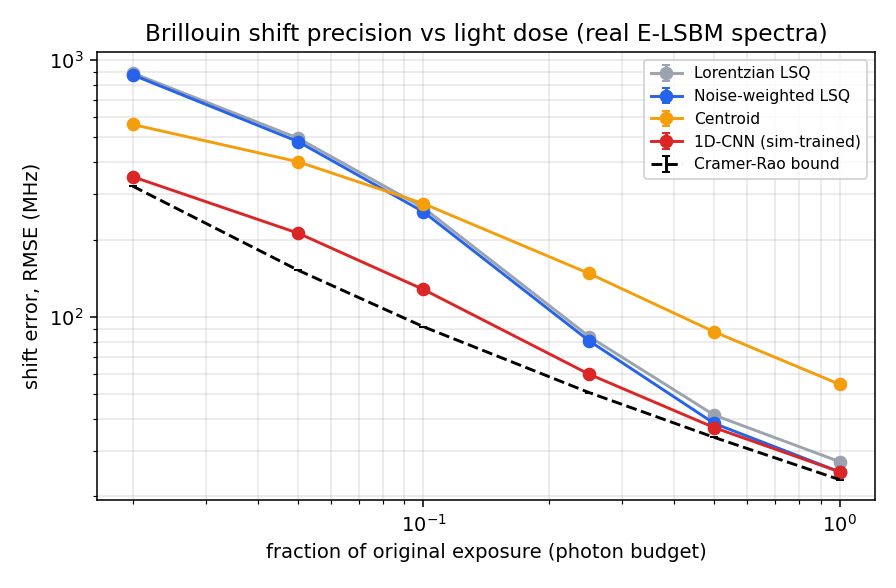
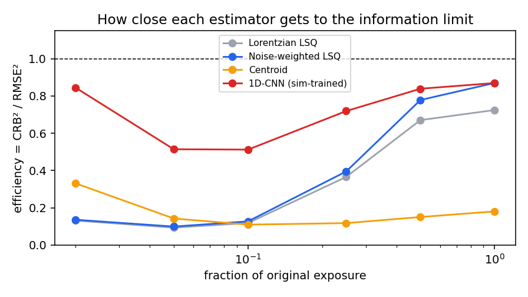

# Brillouin-AI: How much light does a Brillouin microscope really need?

**Project 17 · Husain Naqvi · 2026** · optical biomechanics / spectral estimation · [figure gallery](https://engr-husainnaqvi.github.io/Brillouin-AI/)

Brillouin microscopy measures tissue stiffness without touching the sample, by reading a tiny frequency shift (about 5 GHz) in scattered laser light. The shift has to be measured to within tens of MHz, and the light needed to do that can heat or damage live samples. Most labs read the shift with a least-squares Lorentzian fit.

This project asks a narrow question on **real camera data**: at a given light dose, how close does each way of reading the spectrum get to the **Cramér-Rao bound**, the smallest error any unbiased estimator can achieve with that many photons? It also tests whether a small 1D neural network that has **never seen a real spectrum** (trained only on simulated spectra) can be used directly on the real instrument.

## Data (public: Bevilacqua et al. 2023, *Nature Methods*; Zenodo record 7525851)

- Line-scan Brillouin microscope (E-LSBM), sample: a 0.5 µm bead in agar gel.
- 495 raw camera frames, 241 × 310 pixels. Each camera column holds one Brillouin spectrum, so the data set contains **123,255 real spectra**.
- Everything instrument-specific was measured from the frames themselves, not assumed:
  - **Camera noise.** A photon-transfer fit gives variance = 115.1 × signal + 28,903 ADU² (read noise ≈ 170 ADU).
  - **Frequency axis.** Neighbouring spectral orders give the free spectral range in pixels for each column (15 GHz free spectral range, about 0.21 GHz per pixel).
  - **Sample.** The agar's Brillouin shift measured 5.025 GHz (median; IQR 5.012–5.040).

## How the test works

1. **Reference values.** For each of the 249 usable columns, the reference pair separation is the median of a noise-weighted Lorentzian fit over all 495 frames. Spectra more than 6 robust SDs from that value, or with an implausible linewidth, were excluded before any comparison (6 of 123,255; the bead and failed fits).
2. **Lower light doses.** Each real frame was scaled down to 50%, 25%, 10%, 5% and 2% of its exposure. Exactly the extra shot noise and read noise that a shorter exposure would carry was then added, using the measured camera model, with three noise seeds per dose. The low-light spectra are therefore real line shapes with simulated, not re-recorded, low-light noise.
3. **Estimators compared** on identical spectra:
   - Lorentzian least squares (Levenberg-Marquardt, GPU-batched)
   - noise-weighted Lorentzian least squares
   - intensity centroid
   - **1D-CNN trained only on simulated spectra** (20,000 steps of random Lorentzian pairs with noise drawn from the measured camera model; no real spectrum used in training)
4. **Floor.** The Cramér-Rao bound for every column at every dose, from the Fisher information of the two-Lorentzian model with signal-dependent Gaussian noise.

## Headline results (RMSE of the Brillouin shift, MHz; 123,249 spectra per dose, mean of 3 noise seeds)

| Light dose | Cramér-Rao bound | **1D-CNN (sim-trained)** | Noise-weighted LSQ | Lorentzian LSQ | Centroid |
|---|---|---|---|---|---|
| 100% | 23.2 | **24.9** | **24.9** | 27.3 | 54.6 |
| 50% | 33.9 | **37.0** | 38.4 | 41.4 | 87.4 |
| 25% | 50.7 | **59.8** | 80.7 | 83.8 | 147.5 |
| 10% | 91.5 | **127.8** | 256.3 | 265.8 | 275.9 |
| 5% | 151.8 | **211.7** | 481.0 | 495.9 | 401.6 |
| 2% | 323.0 | **351.5** | 875.5 | 890.1 | 561.3 |

- **At full light, the standard noise-weighted fit is already close to optimal.** It reaches 87% statistical efficiency (CRB² / RMSE²), the same as the CNN.
- **The fits fall apart as light drops; the sim-trained CNN does not.**
  - At 10% light the noise-weighted fit's efficiency falls to 0.13 and the CNN's to 0.51.
  - At 2% light, 23% of fits miss by more than 1 GHz. The CNN misses by that much on 0.6% of spectra.
  - The fits also become biased (+228 MHz at 2% light). The CNN's bias stays within ±6 MHz at every dose.
- **Same precision, less light.** To reach the same RMSE as the weighted fit, the CNN needs:

  | Same RMSE target | Light needed: CNN | Light needed: weighted fit | CNN uses |
  |---|---|---|---|
  | ≈ 60 MHz | 25% | 33% | about 1.3× less light |
  | ≈ 128 MHz | 10% | 17% | about 1.7× less light |
  | ≈ 212 MHz | 5% | 12% | about 2.3× less light |

  Doses come from log-log interpolation of the table above.
- **Speed.** The CNN takes 2.5 µs per spectrum. The GPU-batched fit takes 27 µs, about 10× slower.
- **Sim-to-real transfer worked here.** The network was trained only on spectra simulated from the measured noise model and parameter ranges, and it was never tuned on real data.

## Read this before quoting the numbers

- **Much of the fits' low-light RMSE comes from outright failures.** On *median* absolute error the gap is smaller:

  | Light dose | CNN (MHz) | Weighted fit (MHz) |
  |---|---|---|
  | 10% | 57 | 59 |
  | 5% | 97 | 111 |
  | 2% | 202 | 369 |

  The CNN's main advantage is **robustness**: it does not produce catastrophic misfits. A more careful fit (better starting values, priors, outlier rejection) would close part of this gap, and that comparison was not done here.
- **The bound is a local bound.** At 2% light the CNN's RMSE comes within 9% of the Cramér-Rao bound, but this does not mean it is optimal there. The CNN was trained on a bounded range of separations, so it is not an unbiased estimator, and at very low signal the local bound is not a reliable limit.
- **Lower doses were simulated from real frames, not re-recorded.** Real short exposures can add effects not modelled here, such as drift, background and camera non-idealities.
- **One instrument, one sample (agar), one data set.** Transfer to cells or tissue, with wider linewidths and stronger backgrounds, is untested.
- The reference values come from the noise-weighted fit at full exposure, which slightly favours that method at 100% light.

## Repository contents

| Path | Contents |
|---|---|
| `results/table_summary.csv` | RMSE, SD over seeds, bias, median error, failure rate, time per spectrum, efficiency |
| `results/results_raw.csv` | every dose × seed × method |
| `results/table_rmse_mhz.csv`, `results/table_efficiency.csv` | the two headline tables |
| `results/geometry.csv`, `results/meta.json` | per-column calibration and the measured camera model |
| `docs/` | figure gallery (GitHub Pages) |

Compute: Google Colab, NVIDIA L4 GPU. The full pipeline, from download to tables, takes about 15 minutes.

**Source code and trained model are private.** Academic reviewers can request access via GitHub ([Engr-HusainNaqvi](https://github.com/Engr-HusainNaqvi)).

## Licence

Copyright © 2026 Husain Naqvi. **All Rights Reserved.** See [LICENSE](LICENSE). The data belong to Bevilacqua et al. (Zenodo 7525851) and are not redistributed here; please cite the original work.
